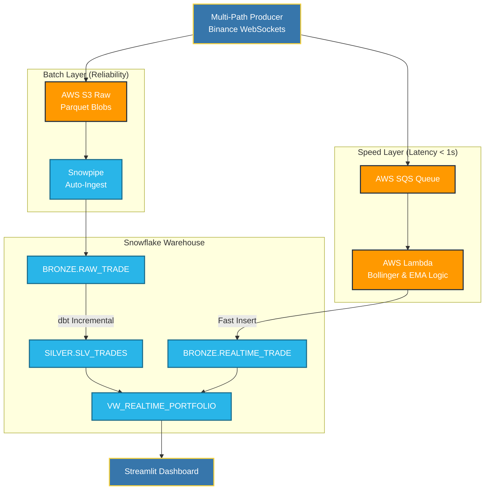

# Alpine Lambda Trade (ALT) 🏔️

**Senior Data Engineering Project: High-Throughput Lambda Architecture (Batch + Speed layers) with AWS & Snowflake.**

ALT consumes high-frequency Crypto Exchange data via WebSockets (Binance), dynamically buffering them into a Data Lake (S3/Parquet) for historical processing, while simultaneously routing live trade subsets through AWS SQS to trigger millisecond-latency Lambda functions for real-time volatility analysis.

-----

## 🏗️ Architecture & Design

The infrastructure is fully provisioned via **Terraform** (Infrastructure as Code), ensuring a reproducible, production-grade, and version-controlled environment.



-----

## 💡 Business & Technical Objectives

This project solves the three core challenges of modern financial data pipelines:

### 1\. Volatility Detection & FinOps Strategy

  * **The Challenge:** High-frequency markets require sub-second detection to avoid slippage.
  * **The Solution:** The **Speed Layer** (SQS + Lambda) calculates **Bollinger Bands** (Upper/Lower) and **EMA** on-the-fly using a stateful "warm start" cache, flagging price anomalies (`SPIKE_DETECTED`) instantly.
  * **FinOps Optimization:** Migrated from Kinesis to **Amazon SQS** to leverage a consumption-based pricing model (Free Tier friendly) without sacrificing performance.

### 2\. Auditability & Immutability (Historical Truth)

  * **The Challenge:** Real-time streams are prone to network retries, late arrivals, and duplicates.
  * **The Solution:** A robust **dbt pipeline** uses **Incremental models** to persist historical records.
  * **Deduplication Logic:** We ensure idempotence via window functions:
    ```sql
    SELECT * FROM (
        SELECT *, ROW_NUMBER() OVER (PARTITION BY trade_id ORDER BY timestamp DESC) as rank
        FROM {{ ref('stg_trades') }}
    ) WHERE rank = 1
    ```

### 3\. Unified Serving Layer

  * **The Challenge:** Reconciling "Old" (Batch) and "Live" (Speed) data without duplication.
  * **The Solution:** A strategic `UNION ALL` in the `VW_REALTIME_PORTFOLIO` view masks overlaps, providing a single, consistent source of truth for the dashboard.

-----

## 🔍 Observability, Quality & Resilience

  * **Pipeline Monitoring:** Tracking the **"Age of Oldest Message"** on SQS to monitor throughput bottlenecks.
  * **Data Quality:** Systematic use of `dbt test` to enforce schema constraints (unique `trade_id`, non-null timestamps).
  * **Resilience:** The Producer implements asynchronous error handling for WebSocket drops, ensuring zero-gap ingestion.
  * **Snowflake Health:** Implementation of `dbt source freshness` to alert on stale data ingestion from S3.

-----

## 🚀 Roadmap: Scaling to Production

  * **Event-Driven Orchestration:** Integrating **Kestra** or **Airflow 3** to manage the lifecycle of the Producer, dbt runs, and infrastructure checks.
  * **Multi-Exchange Fallback:** Implementation of a circuit-breaker to switch between Binance, Kraken, and Coinbase APIs.
  * **Error Handling:** Configuration of a **Dead Letter Queue (DLQ)** for malformed SQS payloads.

-----

## 🛠️ Execution & Setup

### Prerequisites

  - AWS CLI configured.
  - Snowflake Account (Trial or Standard).
  - Python 3.10+ (Recommended: `uv`).

### Deployment

```bash
# 1. Setup Environment
cp .env.example .env  # Update with your credentials

# 2. Provision Infrastructure
make init
make apply

# 3. Launch Pipeline
make run-producer  # Start WebSocket feed
make dbt-run       # Run transformations
make run-dashboard # Launch Streamlit UI
```

-----

## 📚 Research & References

To ensure industry-standard reliability, this project is grounded in the following technical foundations:

  * **[The Lambda Architecture](https://www.oreilly.com/library/view/big-data/9781617290343/) (Marz & Warren):** The core design pattern for balancing low-latency (Speed) with high-throughput (Batch).
  * **[Statistical Monitoring of High-Frequency Data](https://www.google.com/search?q=https://www.researchgate.net/publication/228260655_Statistical_Methods_for_High-Frequency_Data_Analysis):** Theoretical basis for using Bollinger Bands and moving averages for anomaly detection.
  * **[The Unified Logging Layer (Jay Kreps)](https://engineering.linkedin.com/distributed-systems/log-what-every-software-engineer-should-know-about-real-time-datas-unifying):** Foundation for using decoupled, log-based messaging (SQS) to ensure system durability.

-----

*Developed by Michael GARCIA — Built for Scale, Cost-Efficiency, and Resilience.*

